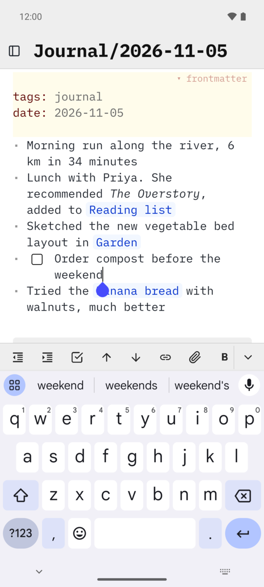

SilverBullet for Android
===

[![Latest release][release badge]][releases]
[![Android 8.0+][android badge]][releases]
[![Built with Kotlin][kotlin badge]][kotlin]
[![License: MIT][license badge]][license]

An Android app for your self-hosted [SilverBullet](https://silverbullet.md) notes, with a thumb-friendly
toolbar, quick capture from anywhere on your phone, and full offline support.

[][obtainium]

&nbsp;

&nbsp;

> [!NOTE]
> This is an unofficial community app. It isn't made by, or affiliated with, the SilverBullet project.
> You need your own SilverBullet v2 server.

## Why an app?

SilverBullet already works as a web app, and it keeps a local copy of your notes so it works offline.
This app wraps that same SilverBullet client and adds what a browser can't:

- **Quick capture from anywhere.** Jot a thought from the home screen, the quick settings panel or
  any app's Share menu, without opening your notes. It's saved even with no connection and sent once
  you're back online.
- **A bottom toolbar** within thumb reach, in place of the small buttons at the top of the screen.
- **Notes that stay put.** Android can clear a browser's saved site data when storage runs low.
  The app's copy of your notes isn't cleared that way.
- **Feels like an app:** stays ready in the background so it reopens quickly, Back closes menus
  first, links open in your browser, and the colours follow your SilverBullet theme, light or dark.

## Features

**Bottom toolbar**
- Sidebar, back, home page, search, today's journal and settings by default.
- Also available: open page, quick capture, run command, and read-only mode.
- Switch each button on or off in Settings.
- Search uses [Silversearch](https://github.com/MrMugame/silversearch) if you have it installed,
  otherwise the page picker.
- Hides while you type, so the formatting bar can take its place.

**Quick capture**
- Opens from the app icon's long-press menu, a quick settings tile, a home-screen widget, or
  **Share** from any app. A shared link becomes a proper markdown link.
- Each line becomes a bullet, added to today's journal page (`Journal/2026-11-05`) or any page you
  choose, such as `Inbox`.
- Works offline, survives restarts, and never overwrites an edit you're making at the same time.

**Formatting bar**
- SilverBullet's own keyboard bar (lists, tasks, indent, links, bold, undo and more) sits right
  above the keyboard and adapts to what you're editing, just like in the browser.

**Offline and sync**
- Uses SilverBullet's own offline mode: read and edit with no connection, and changes sync when
  you're back.
- Works with any SilverBullet v2 server, including ones behind a login, an auth proxy or a VPN
  such as Tailscale.

## Screenshots

<table>
<tr>
<td align="center"> Sidebar</td>
<td align="center"> Quick capture</td>
<td align="center"> Formatting bar</td>
</tr>
<tr>
<td align="center"> Settings</td>
<td align="center"> First run</td>
<td></td>
</tr>
</table>

## Install

**[Obtainium][obtainium]** (recommended) installs the app straight from this repository's releases
and keeps it up to date. Tap the badge above on your phone, or add
`https://github.com/michaelmassoni/silverbullet-android` in Obtainium.

You can also download the APK from [Releases][releases] and install it yourself.

Releases are signed with this certificate (SHA-256), if you want to check:
`6F:B7:35:A5:2C:8F:B4:EC:A7:DE:16:23:BC:0D:77:04:EB:D4:3E:64:C9:72:D3:A5:A9:A2:89:A7:F0:1F:29:6B`

## Getting started

1. Open the app and enter your server's address, for example `notes.example.com`.
2. If your server has a login, sign in on the next screen and tick **Remember me**.
3. Optional: add the **Quick capture** tile to your quick settings panel, or the widget to your
   home screen.

## Good to know

- **Use HTTPS for offline mode.** Android only lets SilverBullet's offline mode run over HTTPS.
  A plain `http://` address on your home network still works, just without offline mode.
  Certificates you've installed on your phone (self-signed or a private CA) are trusted.
- **Quick capture and your login.** Quick capture sends notes using your app login, which
  SilverBullet keeps for 7 days. When it runs out, captures wait and you get a "Sign in"
  notification. To avoid that, set `SB_AUTH_TOKEN` on your server and enter the same token in
  **Settings → API token**.
- **Customise the formatting bar** with the `keyboardBar` setting in your space's `CONFIG` page.
  It's SilverBullet's own bar, so the same configuration works in the browser.

## Contributing

Bug reports and ideas are welcome in [Issues](../../issues). To build the app yourself, see
[BUILDING.md](BUILDING.md).

## License

[MIT](LICENSE). SilverBullet itself is a separate project with its own license.

[release badge]: https://img.shields.io/github/v/release/michaelmassoni/silverbullet-android?style=for-the-badge&color=464CFC
[releases]: https://github.com/michaelmassoni/silverbullet-android/releases
[android badge]: https://img.shields.io/badge/Android-8.0%2B-3DDC84?style=for-the-badge&logo=android&logoColor=white
[kotlin badge]: https://img.shields.io/badge/Built%20with-Kotlin-7F52FF?style=for-the-badge&logo=kotlin&logoColor=white
[kotlin]: https://kotlinlang.org/
[license badge]: https://img.shields.io/badge/License-MIT-blue.svg?style=for-the-badge
[license]: LICENSE
[obtainium]: https://apps.obtainium.imranr.dev/redirect?r=obtainium://add/https://github.com/michaelmassoni/silverbullet-android
